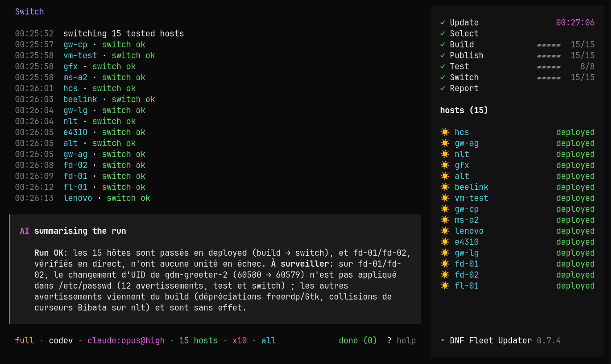
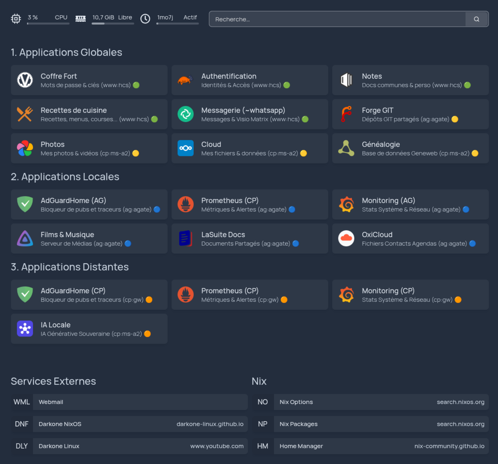
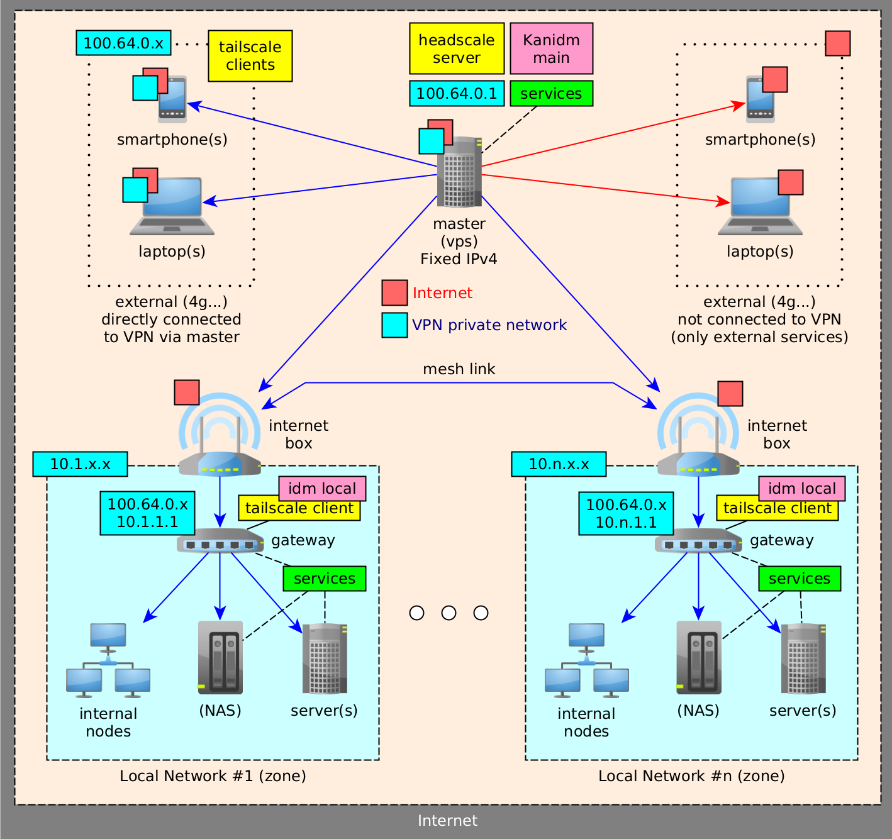
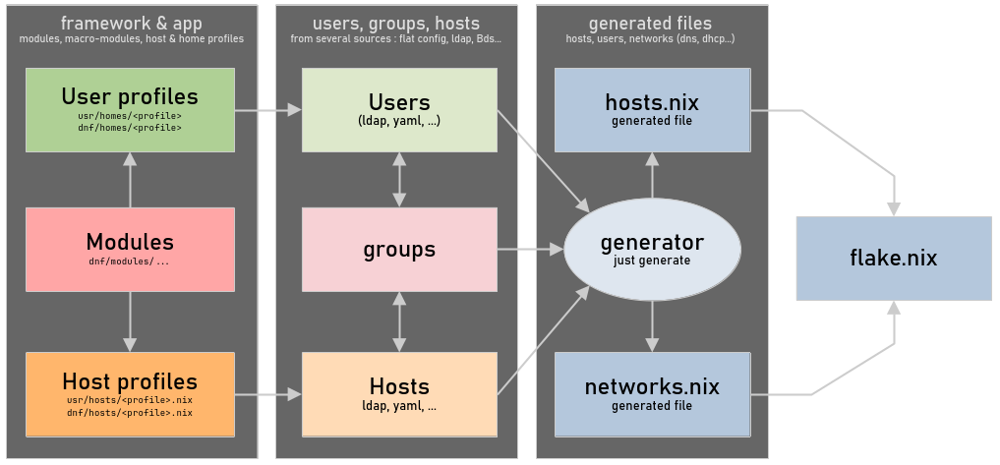
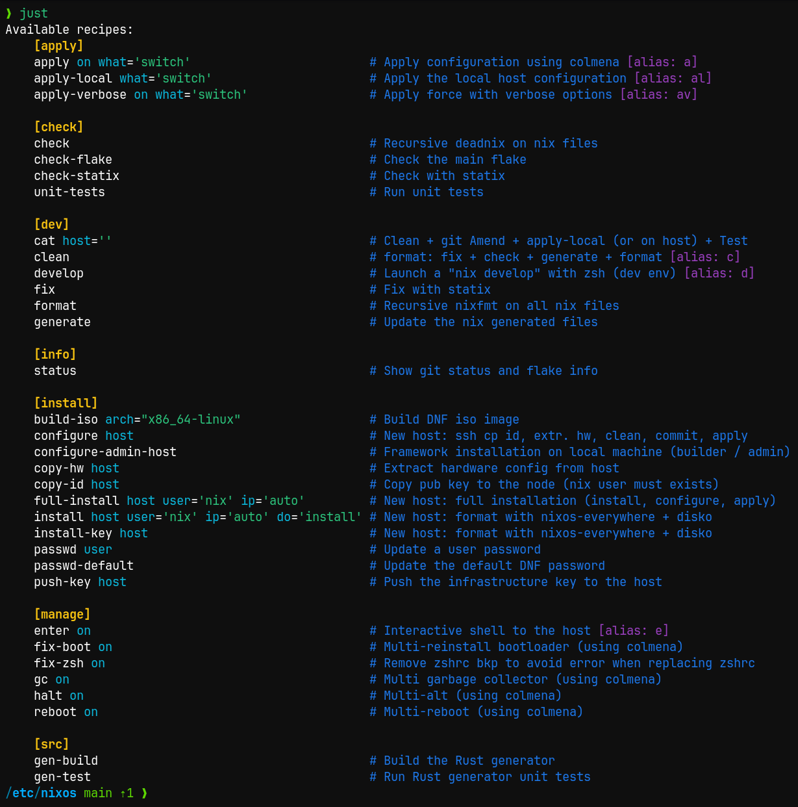
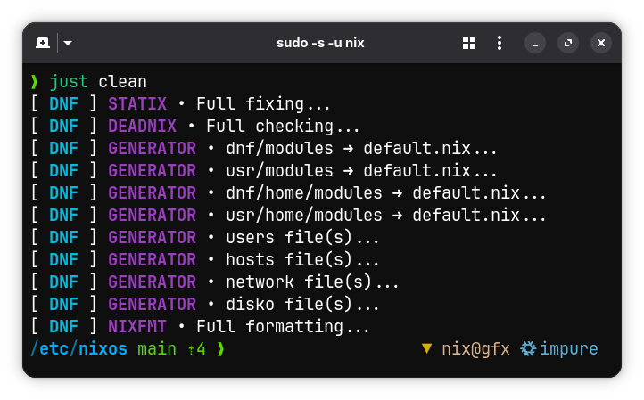
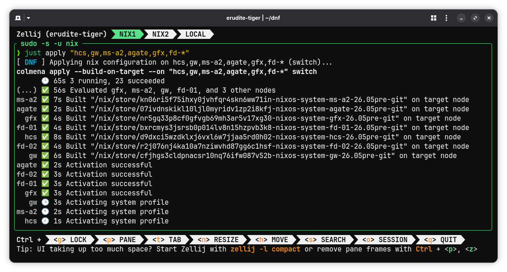

# Darkone NixOS Framework

[](https://github.com/darkone-linux/darkone-nixos-framework/actions/workflows/ci.yml)
[](https://github.com/darkone-linux/darkone-nixos-framework/releases)
[](https://nixos.org/)
[](LICENSE)

- 📖 Documentation : [Officielle FR](https://darkone-linux.github.io/fr/) • [Officielle EN](https://darkone-linux.github.io/en/) • [Readme EN](README.md) • [To-Do FR](TODO.fr.md)
- 🔗 Projets liés : [Boilerplate][boilerplate] • [Exemple](https://github.com/darkone-linux/dnf-example) • [Générateur](https://github.com/darkone-linux/dnf-generator) • [Fleet Update](https://github.com/darkone-linux/dnf-fleet-update) • [Documentation](https://github.com/darkone-linux/dnf-doc)

## Présentation aux utilisateurs (non technique)

### De quoi s'agit-il ?

Un cloud auto-hébergé composé d'un réseau, de services, d'ordinateurs :

- 🌐 Un grand « réseau local » (VPN), rapide et protégé des publicités et des malwares.
- 🗂️ Des services pour gérer ses données : documents personnels, images, médias.
- 💻 Des systèmes Linux (optionnels) pré-installés et très faciles pour non-informaticiens.

### Quels avantages ?

- 🔐 Sécurité maximale (chiffrement) et 100 % souveraine : nos données restent à nous.
- 🚫 Elles ne peuvent être revendues aux assurances, publicitaires et moteurs d'IA.
- 🔁 Sauvegardes 3-2-1 automatisées, chiffrées et distribuées.
- 🕐 Outils, programmes et services utiles, simples, qui font gagner du temps.
- 👶 Profils et services 100 % sécurisés pour les enfants.
- 🔑 Un seul mot de passe pour tous les services, y compris externes (SSO + coffre-fort).

### Principaux services

Pour la plupart de ces services, une seule connexion suffit ! (pas besoin de rentrer 36 fois 36 mots de passe)

|   | Service | Utilité |
|---|---------|---------|
| 🔐 | [Vaultwarden] | Coffre-fort à mots de passe, avec les extensions Bitwarden |
| ☁️ | [Nextcloud] | Cloud personnel : fichiers, partage, synchro ordis et mobiles |
| 📂 | [OxiCloud] | Cloud léger et rapide : fichiers, agendas, contacts |
| 🖼️ | [Immich] | Photos et vidéos, reconnaissance faciale, recherche IA locale |
| 💬 | [Matrix] | Messagerie et visio type « WhatsApp », sûre pour les enfants |
| 📹 | [Jitsi Meet] | Visioconférence, directement dans le navigateur |
| 🎬 | [Jellyfin] | Médiathèque à la « Netflix » : films, séries, musique |
| 📝 | [Outline] | Notes et wiki, personnels ou collectifs |
| 📄 | [Docs] | Édition collaborative de documents (La Suite numérique) |
| 🍽️ | [Mealie] | Recettes de cuisine, menus et listes de courses |
| 🌳 | [GeneWeb] | Arbre généalogique de la famille |
| 🔎 | [SearXNG] | Moteur de recherche privé, sans pistage |
| 🤖 | [Open WebUI] | IA générative locale, propulsée par [Ollama] |
| 🦞 | [OpenClaw] | Assistant IA personnel, dans un [espace IA][espaces IA] privé |
| 🧑‍💻 | [Forgejo] | Forge Git, pour le code et les documents versionnés |
| 🛑 | [AdGuard Home] | Filtre anti-pub et anti-malware pour tout le réseau |

> [!NOTE]
> Les ordinateurs du réseau (sous Linux NixOS) sont 100% pré-installés avec tous les programmes, comptes et configurations.

### Profils d'utilisateurs

Chaque utilisateur est lié à un “profil” (au choix et interchangeable), qui détermine :

* Les programmes installés (éducation, bureautique, jeux…).
* Les configurations (accès internet, services de communication…).

| **Profil** | **Description** |
|----|----|
| ⚪&nbsp;minimal | Compte épuré, avec le strict minimum de programmes. |
| 🔵&nbsp;normal | Bureautique, pour un utilisateur non-informaticien. |
| 🟣&nbsp;avancé | Outils avancés, pour un utilisateur informaticien. |
| 🔴&nbsp;admin | Administration du réseau et des systèmes (expert Linux et Nix). |
| ♿&nbsp;accessible | Poste piloté sans clavier ni souris : toucher, voix, regard. |
| 📘&nbsp;étudiant | Organisation, prise de notes et entraînement pour les études. |
| 🎮&nbsp;joueur | Système épuré, essentiellement des jeux (idéal pour les LANs). |
| 🎒&nbsp;ado | Programmes éducatifs et fun, pour débuter avec Internet. |
| 🧩&nbsp;enfant | Logiciels éducatifs, jeux de réflexion, pas d'accès Internet. |
| 🧸&nbsp;bébé | Apprendre la souris, jouer avec les nombres et les formes. |

### Types d'ordinateurs

Notre réseau local est une bulle sécurisée composée de "nœuds" (ordinateurs) qui peuvent être :

| Type | Utilité |
|------|---------|
| 📱&nbsp;Smartphone,&nbsp;tablette | Je me branche au réseau et à ses services, où que je sois. |
| 💻&nbsp;Mon&nbsp;ordinateur | Windows, macOS ou Linux : il rejoint simplement le réseau. |
| ❄️&nbsp;Poste&nbsp;NixOS | Tout installé, configuré, sécurisé : je n'ai qu'à me connecter. |
| 🗄️&nbsp;Serveur | Toujours allumé, il héberge les services (Jellyfin, Immich…). |
| 🌐&nbsp;Passerelle | Petit bijou entre réseau et Internet : pare-feu, routeur, VPN. |
| 🎼&nbsp;Coordination | Sombre « chef d'orchestre » du réseau, sur Internet (VPS). |

## Présentation technique

Une configuration multi-utilisateur, multi-hôte et multi-service :

- 🔥 [Déclaratif, reproductible, immuable](https://nixos.org/).
- 🚀 [Modules prêts à l’emploi][modules].
- 📝 [Configuration simple](https://github.com/darkone-linux/dnf-boilerplate/blob/main/etc/config.yaml).
- 🧭 [Organisation cohérente][structure].
- 🌍 [Un réseau complet](#une-configuration-pour-un-réseau-complet).
- 🔄 [Mise à jour du parc en une commande](#mise-à-jour-du-parc-en-une-commande), assistée par IA.

Ce projet évolue en fonction de mes besoins. Si vous souhaitez être informé des prochaines versions stables, merci de me le faire savoir sur [GitHub](https://github.com/darkone-linux/darkone-nixos-framework) ou en vous abonnant à ma [chaîne YouTube](https://www.youtube.com/@DarkoneLinux) (FR). Merci !

## Démarrage rapide

Essayer DNF dans une VM, sur un Linux doté de Nix et de KVM :

```sh
nix run github:darkone-linux/darkone-nixos-framework#try
```

- 🖱️ Dans le menu de la VM, choisir **New network** : l'assistant `darkone new` fait le reste.
- 💿 Sur une vraie machine, graver l'ISO d'installation de la [dernière release][releases].
- 📖 Pas à pas : [installation initiale](https://darkone-linux.github.io/fr/doc/admin-guide/install/first-network-installation/).

## Versions

Les versions suivent [SemVer](https://semver.org/). En `0.x`, **la MINEURE porte
les ruptures** (schéma de `etc/config.yaml`, options `darkone.*`, recettes `just`
publiques, organisation de `usr/`) ; la PATCH jamais. `1.0.0` marquera le lancement public.

Épingler une [release][releases] et commiter son `flake.lock` :

```nix
dnf.url = "github:darkone-linux/darkone-nixos-framework/vX.Y.Z";
```

Voir le [CHANGELOG](CHANGELOG.md), le
[guide de montée de version](https://darkone-linux.github.io/fr/doc/admin-guide/maintain/versions/)
et, pour les contributeurs, la [procédure de release](https://darkone-linux.github.io/fr/doc/dev-guide/releasing/).

## Fonctionnalités principales

|   | Fonctionnalité | Description |
|---|----------------|-------------|
| 💿 | Installation assistée | ISO + assistant `darkone new`, [nixos-anywhere] et [disko] |
| 🔄 | Mise à jour du parc | [fleet-update][guide-fleet-update] : build, test par vagues, switch, rapport IA |
| 👤 | Profils utilisateurs | [Profils][profils-utilisateurs] avec [Home Manager] : admin, étudiant, enfant… |
| 🖥️ | Profils d’hôtes | [Profils d’hôtes] : serveurs, passerelles, postes, portables, VM… |
| 🌐 | VPN Tailnet | [VPN maillé] avec [headscale] + [tailscale], [zones indépendantes] |
| 🛡️ | Stop publicités | Internet sûr et sans pub : [AdGuard Home] + pare-feu nftables |
| 🔑 | Connexion unique | SSO avec [Kanidm] : une seule identité pour (presque) tout |
| 🤗 | Services intelligents | [Immich], [Nextcloud], [Matrix], [Jellyfin], [Vaultwarden], [etc.](#principaux-services) |
| 💻 | GNOME épuré | Bureau [GNOME] allégé, avec des applications stables et utiles |
| ♿ | Accessibilité | [Profil umi][accessibilite] : pilotage au toucher, à la voix, au regard |
| 💾 | Sauvegardes 3-2-1 | Sauvegardes robustes, chiffrées et distribuées avec [Restic] |
| 🤖 | IA générative | IA locale : [Open WebUI] + [Ollama], [espaces IA] et agents |
| 🏠 | Page d’accueil | [Page d’accueil automatique](#page-daccueil-dynamique) : accès rapide aux services |

## Sous le capot

|   | Spécificité | Description |
|---|-------------|-------------|
| ❄️ | Déclaratif et immuable | Configuration reproductible, basée sur [Nix / NixOS] |
| 🔐 | Secrets | Stratégie de secrets simple et fiable avec [sops-nix] |
| 💽 | Chiffrement | Disques [LUKS], déverrouillage SSH à distance, [YubiKey] |
| 🧱 | Modules haut niveau | [Modules NixOS][modules] faciles à activer et à configurer |
| 📐 | Architecture | [Extensible et scalable][structure], cohérente et personnalisable |
| ✴️ | Proxy inverse | Services répartis sur le réseau derrière des proxies [Caddy] |
| 🛜 | Réseau automatisé | Plomberie zero-conf (DNS, DHCP, pare-feu…) avec [dnsmasq] |
| 📈 | Monitoring & alertes | [Prometheus], [Grafana], [Loki], [Alertmanager] → Matrix |
| ⚡ | Caches binaires | [Harmonia] et caches de zone, builds répartis sur le parc |
| 📦 | MicroVM | Invités [microvm.nix], déployés et supervisés comme tout hôte |
| 🧪 | Tests | Tests [nix-unit], scénarios en VM NixOS, CI lint et évaluation |

## État du SSO (OIDC / OAuth2)

- **OAuth2** : permet une connexion OAuth2 / OIDC
- **Natif** : pas besoin de plugin ou autre, on peut paramétrer directement
- **PKCE** : prend en charge PKCE
- **Déclaratif** : tous les paramètres peuvent être déclarés dans la configuration
- **OK** : implémentation fonctionnelle

✅ oui · ❌ non · ☑️ script / démon idempotent · 🔁 via OAuth2 Proxy · ℹ️ accès commun, sans SSO

| Application | OAuth2 | Natif | PKCE | Déclaratif | OK | Commentaires |
|-------------|--------|-------|------|------------|----|--------------|
| [Mealie] | ✅ | ✅ | ✅ | ✅ | ✅ | Fonctionne parfaitement |
| [Vaultwarden] | ✅ | ✅ | ✅ | ✅ | ✅ | Bien saisir l'e-mail d'abord |
| [Matrix] | ✅ | ✅ | ✅ | ✅ | ✅ | Via MAS (+Element +Coturn) |
| [Open WebUI] | ✅ | ✅ | ✅ | ✅ | ✅ | Marche bien (+Ollama) |
| [Grafana] | ✅ | ✅ | ✅ | ✅ | ✅ | Marche bien |
| [LaSuite Docs][Docs] | ✅ | ✅ | ✅ | ✅ | ✅ | Marche bien |
| [Immich] | ✅ | ✅ | ✅ | ✅ | ✅ | settings + secretSettings |
| [OxiCloud] | ✅ | ✅ | ✅ | ✅ | ✅ | Compte créé au 1er login |
| [Headscale][headscale] | ✅ | ✅ | ✅ | ✅ | ✅ | Login des appareils perso |
| [Outline] | ✅ | ✅ | ❌ | ✅ | ✅ | Marche bien, sans PKCE |
| [Forgejo] | ✅ | ✅ | ✅ | ☑️ | ✅ | Oneshot add-oauth |
| [Nextcloud] | ✅ | ✅ | ✅ | ☑️ | ✅ | user_oidc, provisionné via occ |
| [OAuth2 Proxy] | ✅ | ✅ | ✅ | ✅ | ✅ | Lié à Caddy et Kanidm |
| [Homepage] | 🔁 | 🔁 | 🔁 | 🔁 | ✅ | Via OAuth2 Proxy |
| [Prometheus] | 🔁 | 🔁 | 🔁 | 🔁 | ✅ | Via OAuth2 Proxy |
| [OpenClaw] | 🔁 | 🔁 | 🔁 | 🔁 | ✅ | Membres de l'espace IA |
| [Jellyfin] | ℹ️ | ℹ️ | ℹ️ | ℹ️ | ℹ️ | Accès communs |
| [AdGuard Home] | ℹ️ | ℹ️ | ℹ️ | ℹ️ | ℹ️ | Accès communs |
| [GeneWeb] | ℹ️ | ℹ️ | ℹ️ | ℹ️ | ℹ️ | Accès communs |

## Mise à jour du parc en une commande

`just fleet-update` met à jour, construit et déploie tout le parc, vague par vague.

- 🔄 Mise à jour → build → publication → test par vagues → switch → rapport.
- 🤖 L'IA analyse les échecs, répare services ou code et résume le lancement.
- ⏰ Lancement quotidien sans surveillance en option, rapport envoyé sur Matrix.
- 📖 Guide : [mettre à jour le parc avec fleet-update][guide-fleet-update].



## Page d'accueil dynamique



## Une configuration pour un réseau complet



## Organisation

À la racine d'un projet DNF :

- `etc/` → configuration principale (`config.yaml`)
- `usr/` → projet local : machines, modules, utilisateurs, secrets
- `var/` → fichiers générés et journaux de déploiement
- `dnf/` → le framework (lien créé par `nix run .#init`)

La [structure complète est documentée ici][structure].

> [!TIP]
> Un nouveau projet part du [boilerplate][boilerplate], ou de
> `nix flake new -t github:darkone-linux/darkone-nixos-framework mon-reseau`.

## Le générateur

```shell
# Lancer le générateur
just generate

# Génération + formattages + checks
just clean
```



Son rôle est de générer une configuration statique pure à partir des machines, utilisateurs et zones déclarés dans `etc/config.yaml`. La configuration Nix générée (`var/generated/`) est intégrée au dépôt afin d'être fixée et utilisée par le flake.

## Exemple

Un poste portable d'administration, déclaré dans `etc/config.yaml` :

```yaml
hosts:
  - hostname: "darkone-laptop"   # Nom du host
    name: "An admin laptop"      # Description du host
    zone: "main"                 # Zone du host (IP dynamique)
    profile: "laptop"            # Profil du host -> fonctionnalités à installer
    users: ["darkone", "john"]   # Utilisateurs à installer sur le host
    groups: ["zone-main"]        # Groupes d'utilisateurs à installer
```

- Des profils de hosts pré-configurés existent dans `dnf/modules/mixin/host`.
- Les utilisateurs liés au host sont déclarés via `users` et/ou `groups`.

> [!NOTE]
> On peut créer un nouveau poste informatique avec nixos-anywhere + disko.
>
> ```sh
> # Création automatique du poste "darkone-laptop"
> just full-install darkone-laptop nixos 192.168.1.234
>
> # Puis mise à jour du poste au fur et à mesure
> just apply darkone-laptop
> ```

## Administration simplifiée avec Just



## Nettoyage & corrections automatiques simplifiées



## Déploiement facile

Déploiement d'une nouvelle génération sur plusieurs hosts à partir de la même configuration.



<!-- Projet et documentation -->
[releases]: https://github.com/darkone-linux/darkone-nixos-framework/releases
[boilerplate]: https://github.com/darkone-linux/dnf-boilerplate
[modules]: https://darkone-linux.github.io/fr/ref/modules/
[structure]: https://darkone-linux.github.io/fr/doc/#structure
[profils-utilisateurs]: https://darkone-linux.github.io/fr/doc/admin-guide/understand/user-profiles/
[Profils d’hôtes]: https://darkone-linux.github.io/fr/doc/admin-guide/understand/host-profiles/
[zones indépendantes]: #une-configuration-pour-un-réseau-complet
[accessibilite]: https://darkone-linux.github.io/fr/doc/admin-guide/operate/accessibility/
[espaces IA]: https://darkone-linux.github.io/fr/doc/admin-guide/operate/ai-spaces/
[guide-fleet-update]: https://darkone-linux.github.io/fr/doc/admin-guide/operate/deploy/#mettre-à-jour-le-parc-avec-fleet-update
[LUKS]: https://darkone-linux.github.io/fr/doc/admin-guide/operate/luks/
[YubiKey]: https://darkone-linux.github.io/fr/doc/admin-guide/operate/yubikey/

<!-- Projets amont -->
[nixos-anywhere]: https://github.com/nix-community/nixos-anywhere
[disko]: https://github.com/nix-community/disko
[Home Manager]: https://github.com/nix-community/home-manager
[VPN maillé]: https://fr.wikipedia.org/wiki/R%C3%A9seau_maill%C3%A9
[headscale]: https://headscale.net/
[tailscale]: https://tailscale.com/
[Kanidm]: https://kanidm.com/
[GNOME]: https://www.gnome.org/
[Restic]: https://restic.net/
[Ollama]: https://ollama.com/
[Nix / NixOS]: https://nixos.org/
[sops-nix]: https://github.com/Mic92/sops-nix
[Caddy]: https://github.com/caddyserver/caddy
[dnsmasq]: https://thekelleys.org.uk/dnsmasq/doc.html
[Prometheus]: https://prometheus.io/
[Grafana]: https://grafana.com
[Loki]: https://grafana.com/oss/loki/
[Alertmanager]: https://prometheus.io/docs/alerting/latest/alertmanager/
[Harmonia]: https://github.com/nix-community/harmonia
[microvm.nix]: https://github.com/microvm-nix/microvm.nix
[nix-unit]: https://github.com/nix-community/nix-unit
[OAuth2 Proxy]: https://oauth2-proxy.github.io/oauth2-proxy/
[Homepage]: https://gethomepage.dev/

<!-- Services -->
[Vaultwarden]: https://github.com/dani-garcia/vaultwarden
[Nextcloud]: https://nextcloud.com/
[OxiCloud]: https://github.com/AtalayaLabs/OxiCloud
[Immich]: https://immich.app/
[Matrix]: https://matrix.org/
[Jitsi Meet]: https://jitsi.org/jitsi-meet/
[Jellyfin]: https://jellyfin.org/
[Outline]: https://www.getoutline.com/
[Docs]: https://lasuite.numerique.gouv.fr/
[Mealie]: https://mealie.io/
[GeneWeb]: https://geneweb.tuxfamily.org/wiki/GeneWeb/fr
[SearXNG]: https://docs.searxng.org/
[Open WebUI]: https://openwebui.com/
[OpenClaw]: https://openclaw.ai/
[Forgejo]: https://forgejo.org/
[AdGuard Home]: https://adguard.com/fr/adguard-home/overview.html
