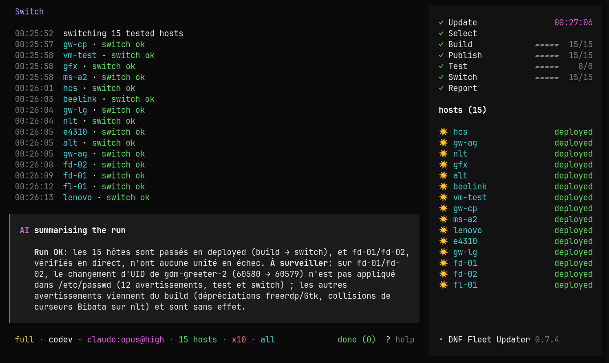
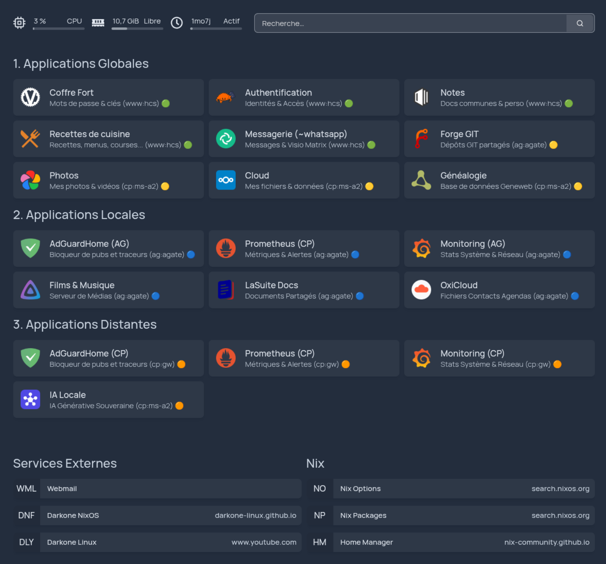
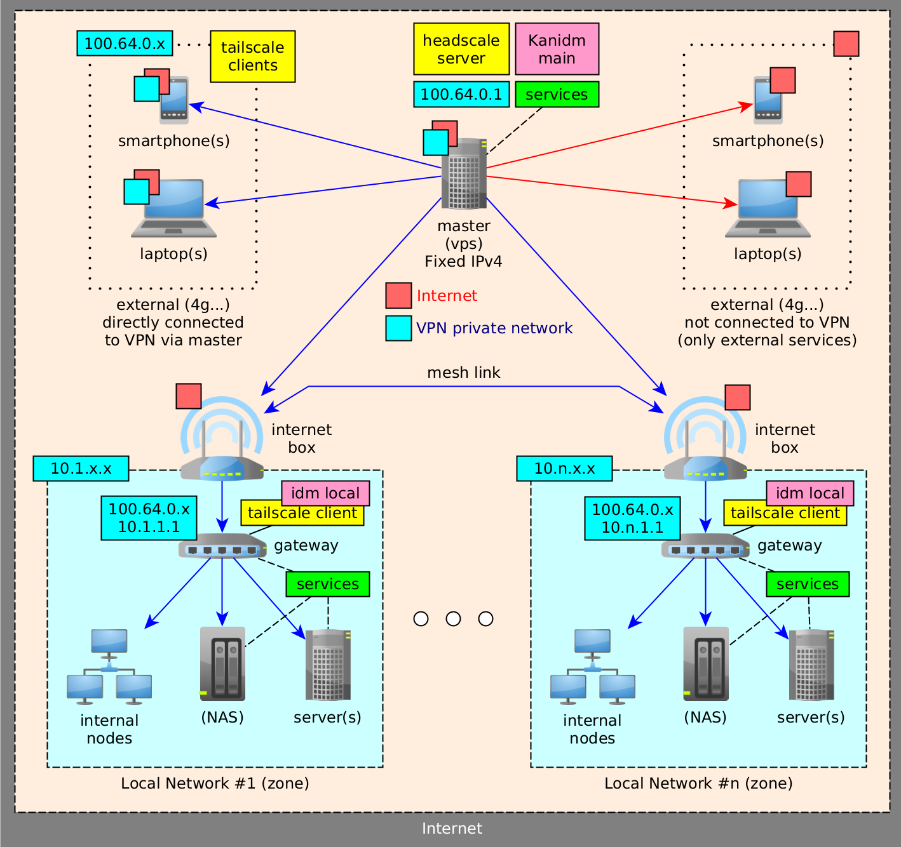
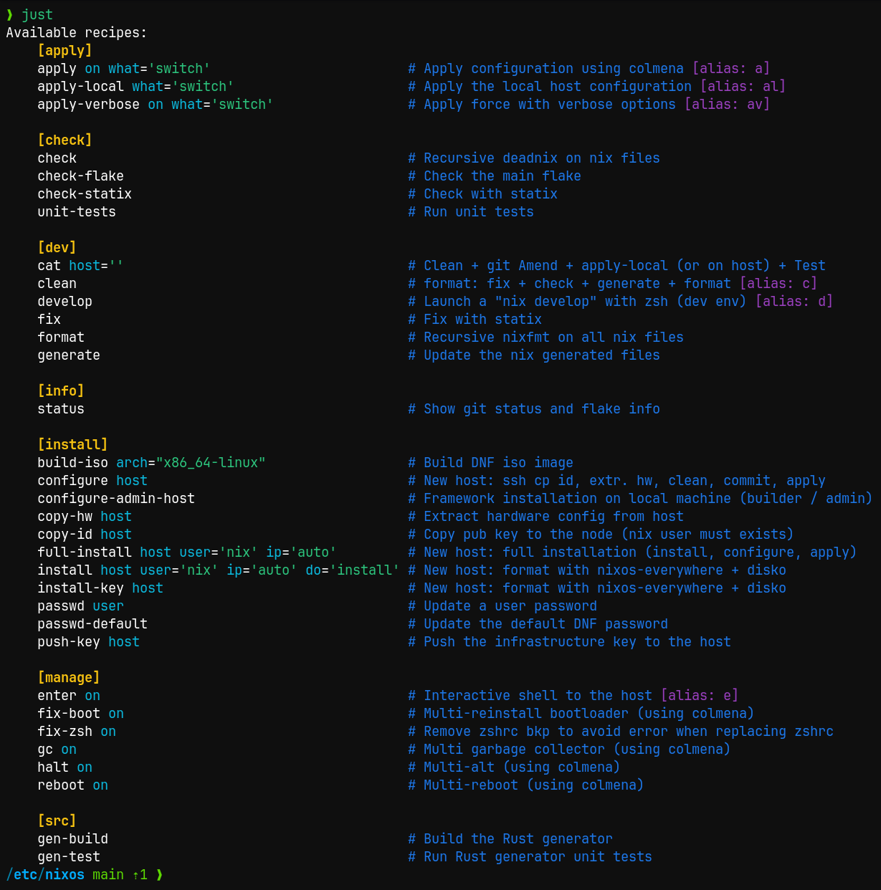
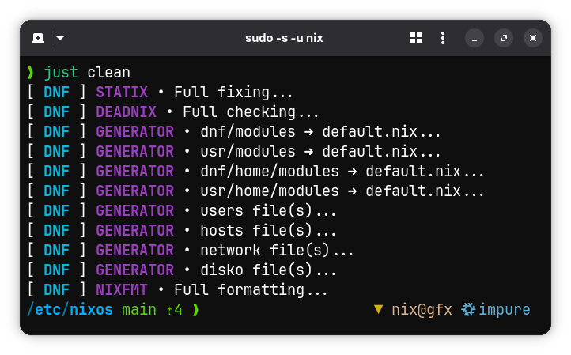
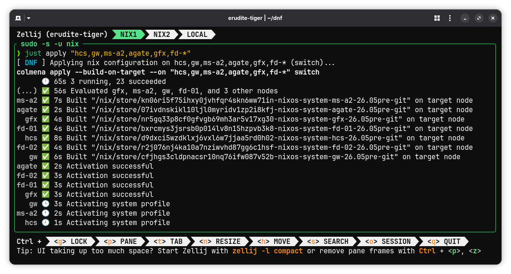

# Darkone NixOS Framework

[](https://github.com/darkone-linux/darkone-nixos-framework/actions/workflows/ci.yml)
[](https://github.com/darkone-linux/darkone-nixos-framework/releases)
[](https://nixos.org/)
[](LICENSE)

- 📖 Documentation: [Official EN](https://darkone-linux.github.io/en/) • [Official FR](https://darkone-linux.github.io/fr/) • [Readme FR](README.fr.md) • [To-Do FR](TODO.fr.md)
- 🔗 Subprojects: [Boilerplate][boilerplate] • [Example](https://github.com/darkone-linux/dnf-example) • [Generator](https://github.com/darkone-linux/dnf-generator) • [Fleet Update](https://github.com/darkone-linux/dnf-fleet-update) • [Documentation](https://github.com/darkone-linux/dnf-doc)

## A multi-user, multi-service & multi-host configuration

- 🔥 [Declarative, reproducible, immutable](https://nixos.org/).
- 🚀 Ready-to-use [modules](https://darkone-linux.github.io/en/ref/modules/).
- 📝 Simple [main configuration](https://github.com/darkone-linux/dnf-boilerplate/blob/main/etc/config.yaml).
- 🧭 Consistent [structure](https://darkone-linux.github.io/en/doc/#structure).
- 🌍 A [full network](#one-configuration-for-a-full-network).
- 🔄 [One-command fleet updates](#fleet-updates-in-one-command), AI-assisted.

This project is constantly evolving according to my needs. If you'd like to be informed about upcoming stable versions, please let me know on [GitHub](https://github.com/darkone-linux/darkone-nixos-framework) or by subscribing to my [YouTube channel](https://www.youtube.com/@DarkoneLinux) (FR). Thank you!

## Getting started

Try DNF in a VM, on any Linux with Nix and KVM:

```sh
nix run github:darkone-linux/darkone-nixos-framework#try
```

- 🖱️ In the VM menu, pick **New network**: the `darkone new` wizard does the rest.
- 💿 On real hardware, flash the installer ISO of the [latest release][releases].
- 📖 Step by step: [first network installation](https://darkone-linux.github.io/en/doc/admin-guide/install/first-network-installation/).

## Versioning

Releases follow [SemVer](https://semver.org/). While in `0.x`, **MINOR carries
the breaking changes** (`etc/config.yaml` schema, `darkone.*` options, public
`just` recipes, `usr/` layout); PATCH never does. `1.0.0` marks the public launch.

Pin a [release][releases] and commit your `flake.lock`:

```nix
dnf.url = "github:darkone-linux/darkone-nixos-framework/vX.Y.Z";
```

See the [CHANGELOG](CHANGELOG.md), the
[upgrade guide](https://darkone-linux.github.io/en/doc/admin-guide/maintain/versions/)
and, for contributors, the [release procedure](https://darkone-linux.github.io/en/doc/dev-guide/releasing/).

## Main features

|   | Feature | Description |
|---|---------|-------------|
| 💿 | Assisted install | Installer ISO + `darkone new` wizard, [nixos-anywhere] & [disko] |
| 🔄 | Fleet updates | [fleet-update][fleet-update-guide]: build, test by waves, switch, AI report |
| 👤 | User profiles | [Profiles][user-profiles] with [Home Manager]: admin, student, gamer, child… |
| 🖥️ | Host profiles | [Host profiles]: servers, gateways, desktops, laptops, VMs… |
| 🌐 | Tailnet VPN | [Full-mesh VPN] with [headscale] + [tailscale], [independent zones] |
| 🛡️ | Ad-free web | Secure, ad-free browsing: [AdGuard Home] + nftables firewall |
| 🔑 | Single sign-on | [Kanidm] SSO: one identity for (almost) every service |
| 🤗 | Smart services | [Immich], [Nextcloud], [Matrix], [Jellyfin], [Vaultwarden], [etc.](#main-services) |
| 💻 | Clean GNOME | Streamlined [GNOME] desktop, with stable and useful apps |
| ♿ | Accessibility | [umi profile][accessibility]: touch, voice and eye-gaze input |
| 💾 | 3-2-1 backups | Robust, encrypted, distributed backups with [Restic] |
| 🤖 | Generative AI | On-premises AI: [Open WebUI] + [Ollama], [AI spaces] with agents |
| 🏠 | Homepage | [Automated homepage](#homepage-screenshot): quick access to every service |

## Under the hood

|   | Specificity | Description |
|---|-------------|-------------|
| ❄️ | Declarative & immutable | Fully reproducible configuration, built on [Nix / NixOS] |
| 🔐 | Secrets | Simple and reliable secret strategy with [sops-nix] |
| 💽 | Disk encryption | [LUKS], remote unlock over SSH, [YubiKey] login and unlock |
| 🧱 | High-level modules | [NixOS modules][modules], easy to enable and configure |
| 📐 | Consistent architecture | [Extensible and scalable][structure], customizable |
| ✴️ | Reverse proxy | Services spread across servers behind [Caddy] proxies |
| 🛜 | Auto-networking | Zero-conf plumbing (DNS, DHCP, firewall…) with [dnsmasq] |
| 📈 | Monitoring & alerts | [Prometheus], [Grafana], [Loki], [Alertmanager] → Matrix |
| ⚡ | Binary caches | [Harmonia] and per-zone caches, builds spread over the fleet |
| 📦 | MicroVMs | [microvm.nix] guests, deployed and monitored like any host |
| 🧪 | Tested | [nix-unit] tests, NixOS VM scenarios, CI lint and eval |

## Main services

|   | Service | Purpose |
|---|---------|---------|
| 🔐 | [Vaultwarden] | Password vault, with the Bitwarden browser and mobile apps |
| ☁️ | [Nextcloud] | Personal cloud: files, sharing, sync with computers and phones |
| 📂 | [OxiCloud] | Fast, lightweight cloud: files, calendars, contacts |
| 🖼️ | [Immich] | Photos and videos, face recognition, local AI search |
| 💬 | [Matrix] | Chat and video calls, kid-safe, bridges to WhatsApp & co |
| 📹 | [Jitsi Meet] | Video conferencing, right in the browser |
| 🎬 | [Jellyfin] | Netflix-like media library: movies, shows, music |
| 📝 | [Outline] | Notes and wiki, personal or shared |
| 📄 | [Docs] | Collaborative document editing (La Suite numérique) |
| 🍽️ | [Mealie] | Recipes, meal plans and shopping lists |
| 🌳 | [GeneWeb] | Family tree and genealogy |
| 🔎 | [SearXNG] | Private metasearch engine, no tracking |
| 🤖 | [Open WebUI] | Local generative AI, powered by [Ollama] |
| 🦞 | [OpenClaw] | Personal AI assistant, in a private [AI space][AI spaces] |
| 🧑‍💻 | [Forgejo] | Git forge for code and versioned documents |
| 🛑 | [AdGuard Home] | Ad and malware blocker for the whole network |

Full catalogue: [service modules](https://darkone-linux.github.io/en/ref/modules/service/).

## SSO status

- **OAuth2**: supports OAuth2 / OIDC
- **Native**: no plugin or external component required
- **PKCE**: supports PKCE
- **Declarative**: all settings can be declared in NixOS
- **OK**: works on my configuration

✅ yes · ❌ no · ☑️ idempotent script / daemon · 🔁 via OAuth2 Proxy · ℹ️ shared access, no SSO

| Application | OAuth2 | Native | PKCE | Declarative | OK | Comments |
|-------------|--------|--------|------|-------------|----|----------|
| [Mealie] | ✅ | ✅ | ✅ | ✅ | ✅ | Works perfectly |
| [Vaultwarden] | ✅ | ✅ | ✅ | ✅ | ✅ | Fill the right e-mail first |
| [Matrix] | ✅ | ✅ | ✅ | ✅ | ✅ | Via MAS (+Element +Coturn) |
| [Open WebUI] | ✅ | ✅ | ✅ | ✅ | ✅ | Works fine (+Ollama) |
| [Grafana] | ✅ | ✅ | ✅ | ✅ | ✅ | Works fine |
| [LaSuite Docs][Docs] | ✅ | ✅ | ✅ | ✅ | ✅ | Works fine |
| [Immich] | ✅ | ✅ | ✅ | ✅ | ✅ | settings + secretSettings |
| [OxiCloud] | ✅ | ✅ | ✅ | ✅ | ✅ | Account created at 1st login |
| [Headscale] | ✅ | ✅ | ✅ | ✅ | ✅ | Personal devices login |
| [Outline] | ✅ | ✅ | ❌ | ✅ | ✅ | Works, without PKCE |
| [Forgejo] | ✅ | ✅ | ✅ | ☑️ | ✅ | add-oauth oneshot |
| [Nextcloud] | ✅ | ✅ | ✅ | ☑️ | ✅ | user_oidc, occ-provisioned |
| [OAuth2 Proxy] | ✅ | ✅ | ✅ | ✅ | ✅ | Linked to Caddy & Kanidm |
| [Homepage] | 🔁 | 🔁 | 🔁 | 🔁 | ✅ | Via OAuth2 Proxy |
| [Prometheus] | 🔁 | 🔁 | 🔁 | 🔁 | ✅ | Via OAuth2 Proxy |
| [OpenClaw] | 🔁 | 🔁 | 🔁 | 🔁 | ✅ | AI space members only |
| [Jellyfin] | ℹ️ | ℹ️ | ℹ️ | ℹ️ | ℹ️ | Common access |
| [AdGuard Home] | ℹ️ | ℹ️ | ℹ️ | ℹ️ | ℹ️ | Common access |
| [GeneWeb] | ℹ️ | ℹ️ | ℹ️ | ℹ️ | ℹ️ | Common access |

## Fleet updates in one command

`just fleet-update` updates, builds and deploys the whole fleet, wave by wave.

- 🔄 Update → build → publish → test by waves → switch → report.
- 🤖 AI analyses failures, fixes services or code, and summarises the run.
- ⏰ Optional daily unattended run, with its report sent to Matrix.
- 📖 Guide: [updating the fleet with fleet-update][fleet-update-guide].



## Homepage screenshot



## One configuration for a full network



## Easy admin with Just



## Easy Nix code clean, generation and fix



## Easy multi-host deployment



<!-- Project & documentation -->
[releases]: https://github.com/darkone-linux/darkone-nixos-framework/releases
[boilerplate]: https://github.com/darkone-linux/dnf-boilerplate
[modules]: https://darkone-linux.github.io/en/ref/modules/
[structure]: https://darkone-linux.github.io/en/doc/#structure
[user-profiles]: https://darkone-linux.github.io/en/doc/admin-guide/understand/user-profiles/
[Host profiles]: https://darkone-linux.github.io/en/doc/admin-guide/understand/host-profiles/
[independent zones]: #one-configuration-for-a-full-network
[accessibility]: https://darkone-linux.github.io/en/doc/admin-guide/operate/accessibility/
[AI spaces]: https://darkone-linux.github.io/en/doc/admin-guide/operate/ai-spaces/
[fleet-update-guide]: https://darkone-linux.github.io/en/doc/admin-guide/operate/deploy/#updating-the-fleet-with-fleet-update
[LUKS]: https://darkone-linux.github.io/en/doc/admin-guide/operate/luks/
[YubiKey]: https://darkone-linux.github.io/en/doc/admin-guide/operate/yubikey/

<!-- Upstream projects -->
[nixos-anywhere]: https://github.com/nix-community/nixos-anywhere
[disko]: https://github.com/nix-community/disko
[Home Manager]: https://github.com/nix-community/home-manager
[Full-mesh VPN]: https://en.wikipedia.org/wiki/Mesh_networking
[headscale]: https://headscale.net/
[tailscale]: https://tailscale.com/
[Kanidm]: https://kanidm.com/
[GNOME]: https://www.gnome.org/
[Restic]: https://restic.net/
[Ollama]: https://ollama.com/
[Nix / NixOS]: https://nixos.org/
[sops-nix]: https://github.com/Mic92/sops-nix
[Caddy]: https://github.com/caddyserver/caddy
[dnsmasq]: https://thekelleys.org.uk/dnsmasq/doc.html
[Prometheus]: https://prometheus.io/
[Grafana]: https://grafana.com
[Loki]: https://grafana.com/oss/loki/
[Alertmanager]: https://prometheus.io/docs/alerting/latest/alertmanager/
[Harmonia]: https://github.com/nix-community/harmonia
[microvm.nix]: https://github.com/microvm-nix/microvm.nix
[nix-unit]: https://github.com/nix-community/nix-unit
[OAuth2 Proxy]: https://oauth2-proxy.github.io/oauth2-proxy/
[Homepage]: https://gethomepage.dev/

<!-- Services -->
[Vaultwarden]: https://github.com/dani-garcia/vaultwarden
[Nextcloud]: https://nextcloud.com/
[OxiCloud]: https://github.com/AtalayaLabs/OxiCloud
[Immich]: https://immich.app/
[Matrix]: https://matrix.org/
[Jitsi Meet]: https://jitsi.org/jitsi-meet/
[Jellyfin]: https://jellyfin.org/
[Outline]: https://www.getoutline.com/
[Docs]: https://lasuite.numerique.gouv.fr/
[Mealie]: https://mealie.io/
[GeneWeb]: https://geneweb.tuxfamily.org/
[SearXNG]: https://docs.searxng.org/
[Open WebUI]: https://openwebui.com/
[OpenClaw]: https://openclaw.ai/
[Forgejo]: https://forgejo.org/
[AdGuard Home]: https://adguard.com/en/adguard-home/overview.html
